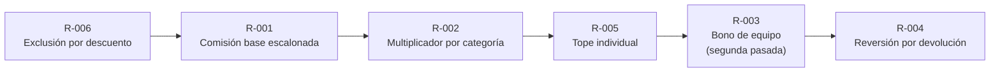
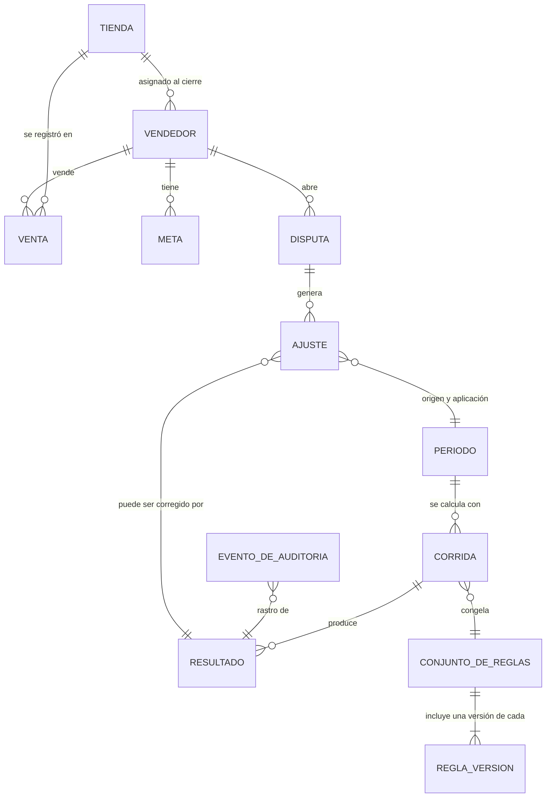
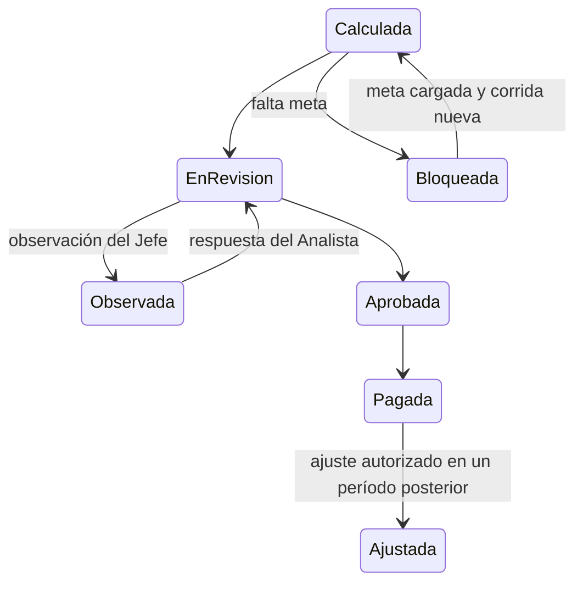
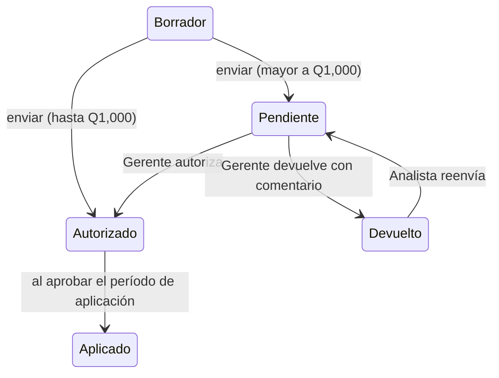

# El modelo antes que las pantallas

Resumen visual del dominio de Voltia. La fuente completa es la sección 3 del [documento maestro](VOLTIA-CASO-COMPLETO.md); el comportamiento está implementado en `src/engine/` y probado en `test/engine.test.mjs`.

## Orden de aplicación



| Regla | Qué hace | Detalle que importa |
|---|---|---|
| R-006 | Excluye ventas con descuento mayor a 25 % | No generan comisión ni suman a la meta; siguen visibles con su motivo |
| R-001 | Fija la tasa según el cumplimiento | La tasa se aplica a **toda** la venta, no solo al excedente |
| R-002 | Multiplica por categoría | Línea blanca 1.0 · Electrónica 1.2 · Accesorios 0.6 · Garantía extendida 2.0 |
| R-005 | Marca comisiones sobre Q15,000 | No recorta: escala al Gerente |
| R-003 | Q500 si la tienda llega al 100 % y el vendedor al 80 % | Depende de un resultado agregado |
| R-004 | Corrige períodos pagados | Con las reglas de **ese** período; descuenta como máximo el 50 % por período |

## Fórmula

```
ventas_comisionables = ventas vigentes del período que R-006 no excluye
cumplimiento         = Σ neto(ventas_comisionables) / meta
tasa                 = escalón de R-001 según el cumplimiento
comisión por venta   = neto × tasa × factor de categoría (R-002)
comisión             = Σ comisión por venta
si comisión > Q15,000 → "requiere autorización" (R-005)
+ Q500 si la tienda ≥ 100 % y el vendedor ≥ 80 % (R-003)
+ ajustes aplicados al período (R-004)
```

## Entidades



## Estados

**Período**

```mermaid
stateDiagram-v2
  [*] --> Abierto
  Abierto --> CerradoAVentas : cerrar a ventas
  CerradoAVentas --> Calculado : ejecutar corrida
  Calculado --> EnRevision : enviar a revisión
  EnRevision --> Calculado : recalcular (corrida nueva)
  EnRevision --> Aprobado : aprobar (Gerente)
  Aprobado --> Pagado : exportar y marcar pagado (Contabilidad)
  Pagado --> [*] : no se reabre; se corrige con ajustes
```



**Resultado de un vendedor**



**Ajuste**



**Regla**: `borrador → vigente → suspendida / vencida`. Editar una regla vigente crea una versión nueva en borrador; activarla requiere la aprobación del Gerente.

**Disputa**: `abierta → en análisis → resuelta a favor | rechazada`. Si se resuelve a favor, genera ajustes.

## Permisos

| Acción | Analista | Jefe de tienda | Gerente | Contabilidad | Auditoría | Vendedor |
|---|---|---|---|---|---|---|
| Crear y editar reglas | Sí | No | No | No | No | No |
| Activar una versión de regla | Solicita | No | Aprueba | No | No | No |
| Ejecutar corrida | Sí | No | No | No | No | No |
| Ver resultados | Todas | Su tienda | Todas | Todas | Todas | El suyo |
| Marcar observaciones | Sí | Su tienda | Sí | No | No | No |
| Aprobar período | No | No | Sí | No | No | No |
| Autorizar excepciones (tope) | No | No | Sí | No | No | No |
| Preparar ajustes | Sí | No | No | No | No | No |
| Autorizar ajustes mayores a Q1,000 | No | No | Sí | No | No | No |
| Exportar y marcar pagado | No | No | No | Sí | No | No |
| Abrir disputa | No | No | No | No | No | Sí |
| Resolver disputa | Sí | Opina | Aprueba si genera ajuste | No | No | No |
| Ver historial de auditoría | Sí | Su tienda | Sí | Sí | Completo | No |

La matriz está implementada en `src/app/permisos.js` y cada botón deshabilitado explica por qué.

## Mapa por rol

```
Analista de Compensaciones
├── Reglas ............ P01 lista · P02 constructor · P10 simulador
├── Períodos .......... P04 corrida · P05 revisión · P03 detalle
├── Correcciones ...... P09 ajustes · P08 disputas
└── Rastro ............ P12

Jefe de tienda ........ P05 revisión · P03 detalle (su tienda) · P08 opina · P12 (su tienda)
Gerente Comercial ..... P06 aprobación · P09 ajustes y excepciones · consulta de P01, P04, P05, P08, P12
Contabilidad .......... P07 pagos · consulta de P04, P05, P12
Auditoría ............. P12 completo · consulta de P01, P04, P05, P09, P08, P03 (solo lectura)
Vendedor (móvil) ...... P11 mi comisión · P08 disputas · P03 simplificado
```
